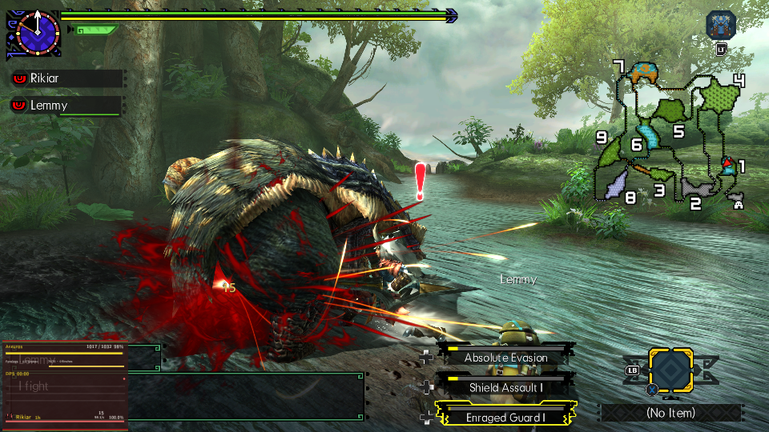
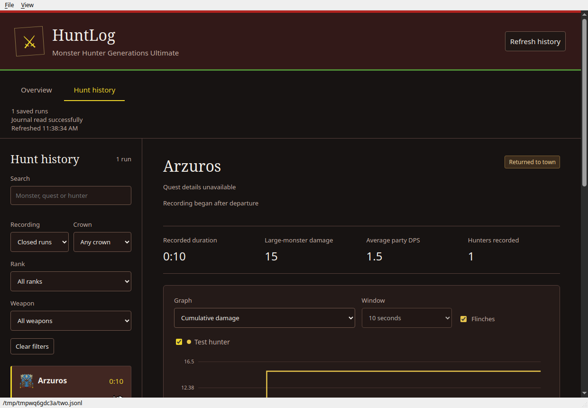

# HuntLog for MHGURecomp

One Forge plugin provides a monster HP HUD, hunt damage meter, status countdowns
and background hunt recording. The desktop dashboard reads those recordings
locally to show hunts, monsters, equipment, rewards and damage graphs.

| HP HUD and Damage Numbers | Desktop dashboard |
| --- | --- |
|  |  |

[Download the mod](https://github.com/Rikiar73574/mhgu-huntlog/releases/latest/download/huntlog-mod.zip) | [Windows and Linux releases](https://github.com/Rikiar73574/mhgu-huntlog/releases)

## Install the mod

MHGU 1.4.0 English data and stock MHGURecomp with built-in Forge are required.
Extract `huntlog-mod.zip` into `mods/HuntLog/`, enable HuntLog, and restart.
The plugin must be at `romfs/nativeNX/plugins/hunter_hud.nro` inside that folder.
Keep only one HuntLog/DPS-meter NRO. Preserve a separate save backup.

Open Insert → Plugin UI → HuntLog to configure the HUD and save its settings.
The gameplay HUD is passive. Names remain hidden until discovered by default.
Part bars show live stagger and sever pools; part labels and required flinches
depend on mapped metadata. A stagger does not automatically mean a part broke.
Anatomical labels appear only when the complete pool signature matches.
Recording continues when the HUD or DPS display is hidden. The journal
`hunter_hunts.jsonl` and `hunter_hud.ini` live beside the game's save files.
HuntLog does not replace character saves. A crash can lose the buffered tail;
an unclosed run remains incomplete.

## Desktop dashboard

Use the Windows or Linux desktop application from the same release. It includes
the dashboard and runtime dependencies; no separate Python installation is
needed. Open a `hunter_hunts.jsonl` journal if the default save slot is elsewhere.
The app reads records and does not edit your journal or character saves.

Default Windows journal: `%APPDATA%\MHGURecomp\save\save_0\hunter_hunts.jsonl`.
Linux/Wine defaults are detected by the application. Portable/custom saves can
always be selected explicitly. Old records retain unknown fields when the
recorder did not capture them. See [dashboard documentation](history/README.md).

## Build and test

The mod needs Rust nightly-2026-11-02 with rust-src, Python 3, and LLD supplied
by Rust. No game dump is needed to build this complete source tree. Forge SDK
is locked to one commit; Cargo.lock is included. Node.js runs the dashboard's
presentation regression test. Desktop build instructions are supplied with
the desktop build tool. To build the native application on its target OS:

```sh
python3 -m venv .venv
# Activate .venv using your shell, then:
python -m pip install -r requirements-desktop.txt
python tools/build_app.py
```

This creates `dist/HuntLog-Windows-x64.zip` on Windows or
`dist/HuntLog-Linux-x64.tar.gz` on Linux. Windows uses its native Python build;
PyInstaller does not cross-compile the desktop executable. Source runs use
`python tools/desktop.py`; `python tools/website.py` retains the optional local
browser launcher. The native window and that launcher use the same parser/UI.

```sh
rustup toolchain install nightly-2026-11-02 --component rust-src
./combined/build-local.sh --online  # first dependency fetch and build
make                            # subsequent locked, offline build + Rust tests
make test                       # Rust, Python and JavaScript checks
python3 tools/package.py         # dist/huntlog-mod.zip
python3 tools/package.py --source
```

With desktop dependencies installed, the Python suite also exercises the native
window. Headless Linux builders should run that suite under `xvfb-run -a`.

`build/hunter_hud.nro` is the combined HUD/recorder artifact. The older C-only
HUD is not part of this project. To reuse a populated portable toolchain/cache,
set `MHGU_TOOLCHAIN=/path/containing/rustup-and-cargo`; set
`MHGU_RUST_TOOLCHAIN=nightly` only when that alias is the pinned toolchain.
Build flags remap source/toolchain paths before producing public binaries.
Packaging rejects malformed NROs and workstation paths. All loaded plugins
share Recomp's 12 MiB image+BSS region; pass each companion NRO with
`tools/package.py --other-plugin /path/plugin.nro` to check the combined budget.

Runtime/source archives use explicit allowlists and include `SHA256SUMS`:

```sh
sha256sum -c SHA256SUMS
```

See [validation and limits](docs/validation.md) and
[third-party notices](THIRD_PARTY_NOTICES.md). Authored changes are MIT;
upstream code, game content, fonts and desktop libraries retain their notices.

Linux desktop archives use the system C++ runtime and fontconfig, so newer graphics drivers and system fonts remain compatible. Build on the oldest supported distribution; the release targets glibc 2.35 or newer.
